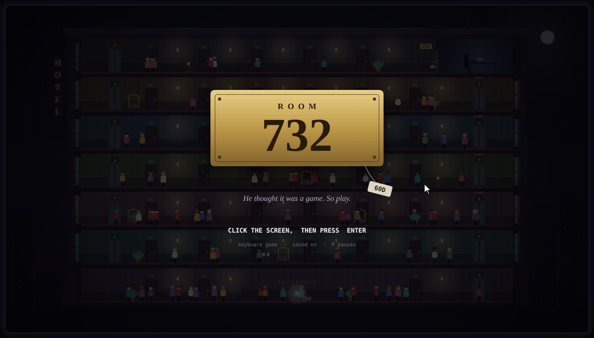
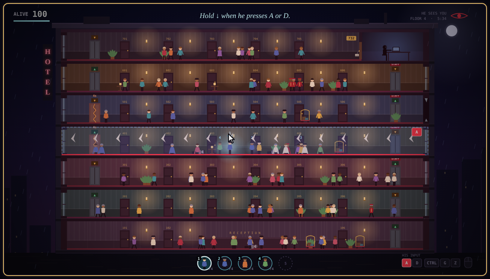

# Room 732

A bored boy finds a laptop in room 732 that controls the whole hotel. He kills a man by accident. That man is you.

You are dead, not gone. Borrow the living, climb seven floors, and break the laptop before he empties the hotel.

**[Play it in your browser](https://mohib-ur-rehman-automation.github.io/room-732/)** (enable GitHub Pages on this repo and it runs at `https://<your-username>.github.io/room-732/`)

## How to play

You are watching the boy's screen. His cursor and his key presses are visible, and they are your warning.

| Key | What it does |
| --- | --- |
| ← → | Walk. With no body, drift. |
| ↑ | Use a stair door. Hold at a locked door or at 732 to break it. |
| Hold ↓ | Brace when he presses A or D to shove a hallway. |
| E | Tether someone close. Stand still while the thread forms. |
| 1–5 / Tab | Become a tethered body. |
| P / M | Pause (with volume sliders) / mute. |

- You can hold five souls and wear one at a time. A slot only frees when that body dies.
- Tether someone on the floor above and you can jump up without the stairs.
- Die with no tether left and the soul sinks through the floors. Catch a body before it fades.
- He does not know which guest is you. Long straight walks, stairs, tethering and breaking doors give you away. Watch the eye.
- Staff-only stairwells open for a bellhop. Anyone else has to break them.

He learns as the night goes on: grabbing people, dropping furniture, melting doors shut (Ctrl+G), raising the dead (Ctrl+Z).

## About

One HTML file. No libraries, no images, no build step. Graphics are drawn on a canvas and all music and sound are synthesized in the browser.

Concept and direction by the Mohib Ur Rehman. Code written by Claude  (Anthropic).

## License

MIT. See [LICENSE](LICENSE).
